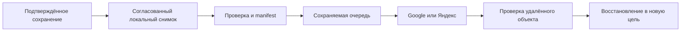

# Вход пользователей, хранение и облачные копии: аудит SmartSQL

Дата: 16 октября 2026. Статический аудит текущего кода и исследование официальной документации выполнены основным агентом и тремя субагентами. Личные БД/аккаунты/облака не подключались; серверы, установки и глобальные настройки не менялись. Это аудит и проект следующего цикла, **не реализация облака или новая UI-приёмка**. Последняя проверенная основа приложения — T12, 614 тестов/60 PostgreSQL-фактов; в этом документальном срезе тесты повторно не запускались.

Пользователь подтвердил: первыми облаками будут **Google Диск и Яндекс Диск**, основной сценарий — **автоматические копии и восстановление**. Одновременная работа предпочтительна через сервер; нужен также понятный недорогой вариант работы команды. Mail и остальные назначения — последующие кандидаты, без обещания универсальной совместимости.

Детальные материалы: [пробелы onboarding/импорта с исходниками](audits/ONBOARDING_CODE_FINDINGS.md), [СУБД, требования и официальные ссылки](audits/DATABASE_ENTRY_PATHS.md), [облачные протоколы и проверки](audits/CLOUD_STORAGE_OPTIONS.md).

## 1. Ответы для трёх исходных пользователей

| С чем пришёл человек | Первый путь в продукте | Что должно работать/быть установлено |
| --- | --- | --- |
| Уже работает с PostgreSQL | «Подключить существующую базу» → адрес/БД/отдельный пользователь/TLS → просмотр | PostgreSQL должен работать там, где находится база. Для удалённой БД локальный PostgreSQL не нужен; pgAdmin/DBeaver и другой GUI не обязательны. Их можно продолжать использовать с той же базой; конфликтующие изменения проверяются отдельно. Перенос данных не требуется. |
| Уже имеет SQLite-файл | «Открыть базу или проект» → подтверждение формата/пути → просмотр | SQLite встроен в SmartSQL. Другой редактор/сервер не нужен. При первом открытии нет миграции или импорта в managed-проект; права записи включаются отдельно. Живые WAL/служебные файлы нельзя терять при подготовке копии. |
| Понимает СУБД, но ничего не установлено | «Создать локальную базу» либо «Помочь выбрать сервер» | Для личной локальной работы достаточно self-contained SmartSQL со встроенным SQLite. PostgreSQL нужен при соответствующей задаче/совместной работе: отдельная установка/сервер и пошаговая инструкция. Знание SQL само по себе не требует установки сервера. |
| Работал только в Excel | «Начать из Excel/CSV» → лист/заголовок/preview → новый локальный проект | Знание SQL и отдельная СУБД не требуются. После импорта ясно показаны созданный файл, место хранения, автосохранение и настройка копий. Исходная книга остаётся исходником, двусторонняя синхронизация с Excel не подразумевается. |

Сейчас реально поддерживаются **SQLite и PostgreSQL**. MySQL/MariaDB/SQL Server остаются планом: их нельзя показывать как работающие подключения. `.sql` — скрипт, `.xlsx` — книга, SQLite — файл базы; один общий диалог обязан объяснить обнаруженный вид и доступный путь. Старую СУБД не нужно заменять ради текущего SmartSQL.

Основания: embedded SQLite в [Infrastructure.csproj](../src/SmartSQL.Infrastructure/SmartSQL.Infrastructure.csproj), native PostgreSQL-драйвер/настройки в [PostgresDatabaseBrowser](../src/SmartSQL.Infrastructure/PostgresDatabaseBrowser.cs); [SQLite serverless](https://www.sqlite.org/serverless.html), [архитектура PostgreSQL](https://www.postgresql.org/docs/current/tutorial-arch.html). Отдельные client utilities понадобятся для конкретных задач вроде PostgreSQL dump/restore; базовое подключение их не требует.

## 2. Дополнительные аудитории и условия

| Условие | Что предусмотреть |
| --- | --- |
| Один человек, один ПК, нет интернета | Полностью локальная работа без обязательного аккаунта; локальные версии/восстановление; облако ждёт подключения. |
| Сотрудник организации, права только SELECT | Удалённая БД с минимальной ролью, проверкой TLS и явным scope; отсутствие прав не маскируется как пустая база. Секреты/организационные данные не отправляются в облако без выбора владельца. |
| Команда, одновременные изменения | Общий PostgreSQL, индивидуальные роли, серверные транзакции и guards приложения. Presence/chat/совместный документ этим не обещаются. |
| Несколько ПК одного человека | Позднее — выбор и восстановление проверенной версии. Две ветки сохраняются отдельно; облачная копия сама по себе не синхронизирует рабочие изменения. |
| ПК без D:, без admin-прав, закрытая сеть | Подготовленная автономная поставка, устойчивый доступный пользователю каталог, понятная ошибка прав/места; отдельная корпоративная инструкция. Нет скрытой установки СУБД или открытия портов. |
| Аналитик/разработчик, чужая тестовая база | Read-only по умолчанию, точные типы/NULL, отдельная копия/тестовый сервер; ограничения SQL/изменений раскрыты. |
| Пожилой/неопытный пользователь, клавиатура, High DPI | Понятные действия и названия, полный путь/статус, доступный фокус, читаемые ошибки, отмена без потери данных; обязательная T23-приёмка. |
| Пользователь неподдерживаемой СУБД/Access/формата Excel | Честное сообщение «пока не поддерживается», официальный следующий путь/совместимый экспорт с раскрытием потерь. Нет обещания открыть любой файл по расширению. |

Входы в продукт: ссылка на нашу проверенную поставку/будущие GitHub Releases, рекомендация коллеги, развёртывание IT, portable ZIP на офлайн-ПК. Публичный установщик, подпись, обновление и восстановление данных после переустановки ещё нуждаются в T24. Сейчас EXE/ZIP опубликованы локально, публичный installer не объявляется готовым.

## 3. Первый полезный экран

Предлагается единая точка входа с четырьмя действиями: **«Начать из Excel/CSV»**, **«Создать локальный проект»**, **«Подключить существующую базу»**, **«Восстановить из копии»**. Рядом — недавние проекты/подключения, «Попробовать пример» и «Помочь выбрать СУБД». Явный выбор Simple/Advanced и его запоминание сохраняются; режим не меняет права БД.

До выбранного действия не создавать пользовательский проект. Открытие сначала определяет формат в режиме чтения, создание работает с новым путём. Если файл отсутствует, «Открыть» сообщает об этом и не создаёт новый. У уже существующего managed-проекта показывать версию/копию до необходимого upgrade. Автоматический поиск чужих баз/паролей и установка сервера не входят в этот поток.

Для Excel нужен один мастер, а не предварительное проектирование пустой таблицы: источник → лист/диапазон/заголовки → таблица/поля → **исходные и фактически сохраняемые значения** → новый файл → результат. По умолчанию сохранять текстовые идентификаторы как текст. До записи явно разобрать leading zeros, длинные числа, даты/время, пустоту/NULL/пробелы, формулы и несколько листов. Неподдерживаемое не отбрасывать; отмена оставляет исходник и проект неизменными. Для append в существующую таблицу показывать риск повторов и обеспечить восстановимый batch/предзаписную копию.

Изменение существующей managed-семантики пустого текста/NULL требует отдельного решения о совместимости и версии проекта. До него мастер обязан раскрыть преобразование или отказать, а не обещать сохранение различий, которые текущий тип не представляет. Сам аудит семантику хранения не меняет.

Для серверного выбора — короткое объяснение «личная локальная база / общая база команды» и каталог проверенных официальных страниц. Для PostgreSQL использовать [официальные Windows downloads](https://www.postgresql.org/download/windows/) и upstream-инструкцию; ссылка на GitHub допустима только для подтверждённого официального проекта. Различать «драйвер уже в SmartSQL», «клиент администрирования», «сервер». Не предлагать устанавливать все СУБД сразу или самостоятельно вводить DDL с неограниченными правами.

## 4. Выявленные препятствия до широкого распространения

Здесь P0 — риск сохранности/непригодность поставки для заявленной среды; P1 — обязательный пользовательский путь, отсутствующая гарантия или неоднозначный интерфейс. Это статические выводы, не заявленная ручная репродукция.

| Приоритет | Подтверждённый пробел | Основание и требуемый результат |
| --- | --- | --- |
| P0 | Пустой обычный SQLite, ошибочно открытый как проект, может получить managed-схему | [SqliteWorkspace:44](../src/SmartSQL.Infrastructure/SqliteWorkspace.cs#L44), [OpenManaged:639](../src/SmartSQL.Desktop/Views/WorkspaceWindow.cs#L639). Разделить create/open; unknown/empty SQLite при open остаётся неизменным. |
| P0 | Данные по умолчанию зависят от папки версии, а EXE и launcher используют разные корни | [WorkspacePaths:10](../src/SmartSQL.Desktop/WorkspacePaths.cs#L10), [launcher:40](../scripts/Run-Published.ps1#L40). Устойчивый каталог данных/профилей/очереди вне бинарников; обновление и оба способа запуска находят одни проекты. Миграция только из явно выбранного старого каталога, без удаления исходного. |
| P0 для публичной поставки | Installer/launcher и native SQLite prewrite backup требуют D: | [installer:23](../packaging/windows/SmartSQL.iss#L23), [launcher:15](../scripts/Run-Published.ps1#L15), [backup:17](../src/SmartSQL.Infrastructure/NativeSqliteEditingBackup.cs#L17). Это осознанная текущая dev-policy; отдельная product-policy должна работать без D:. Прямой EXE сам по себе не запрещает другие диски. Правило D: для нашей разработки сейчас не меняется. |
| P1 | До намерения пользователя уже создаётся default project; нет пути XLSX → новый проект/таблица | [shell:213](../src/SmartSQL.Desktop/Views/WorkspaceWindow.cs#L213), [Spreadsheet import](../src/SmartSQL.Desktop/Views/MainWindow.Spreadsheets.cs). Welcome/мастер и понятный выбор места; исходники не меняются. |
| P1 | Preview импорта не полностью показывает нормализацию; возможна потеря представления идентификаторов/пустот | [детальный разбор](audits/ONBOARDING_CODE_FINDINGS.md). Preview «будет сохранено», явные преобразования и воспроизводимый обратный путь; нельзя восстановить точность, уже потерянную Excel. |
| P1 | Нет облачного назначения, очереди, подтверждения удалённой копии и cloud restore | [текущая матрица](CAPABILITY_MATRIX.md). Нужны Google/Яндекс и полная приёмка backup/restore, а не только кнопка OAuth. |
| P1 | Managed backup нельзя напрямую считать готовым общим upload pipeline | [CreateBackup:103](../src/SmartSQL.Infrastructure/SqliteWorkspace.cs#L103) использует корректный SQLite Backup API, но пишет выбранный конечный путь без общего временного/проверенного publish-процесса. Для облака ввести отдельный проверенный артефакт, лимиты/отмену и долговечный журнал. |
| P1 | Нет единого «Где мои данные / Мои копии / Недавние» | Полный путь встречается в отдельных экранах; возврат к проекту/копии должен быть общим действием. Один каталог/аккаунт не должен ошибочно подменять другой. |

Уже полезны: native read-only по умолчанию, отдельное разрешение записи, checked prewrite backup SQLite, guarded PostgreSQL writes, атомарные batch imports/exports, safety backup при managed restore. Их нужно сохранить. Эти гарантии не равнозначны завершённой облачной системе или полной UX-приёмке.

## 5. Облачное сохранение: пользовательское обещание

Надёжность — успешный commit, согласованный проверенный снимок, сохраняемая очередь доставки и проверенное восстановление. Облачная доступность зависит от сети, квоты и аккаунта; ошибка должна оставаться видимой и не превращаться в ложный успех.

Быстрый доступ: постоянная **кнопка облака со статусом** в оболочке, рядом с настройками внешнего вида/режима, без вытеснения уже закреплённых кнопок. На минимальном размере адаптивная компоновка сохраняет доступ ко всем трём. Одно нажатие открывает аккаунты/назначения, расписание, последнюю копию, «Создать сейчас», «Восстановить», ошибки/повтор. Состояние относится к активному проекту/БД; общий индикатор показывает проблемы других назначений.

| Надпись | Когда допустима |
| --- | --- |
| «Сохранено на компьютере» / «Сохранено на сервере» | Только после подтверждённого commit соответствующего провайдера. Не после ввода текста или отправки запроса с неизвестным COMMIT. |
| «Google: копия проверена 16:40» и отдельно «Яндекс: ожидает сеть» | Отдельно подтверждён каждый выбранный destination; возраст/время и scope снимка видны. Успех одного не скрывает ошибку второго. |
| «Копирование не настроено» / «Нужно войти снова» / «Недостаточно места» | Честные самостоятельные состояния с доступным действием. Локальная работа продолжает сохраняться, если её диск/БД доступны. |
| «Передано в папку облачного клиента» | Подтверждена локальная запись в sync folder; это ещё не доказательство получения облаком. |
| «Восстановление проверено» | Конкретная версия действительно скачана, проверена и открыта в изолированной цели. Одна checksum не доказывает restore. |

Первоначальное подключение добровольное: один или оба сервиса и явный выбор набора данных. Для корпоративного PostgreSQL право просматривать данные не подразумевает разрешение копировать их в личное облако. Не загружать пароли, OAuth tokens, историю SQL и временные файлы вместе с проектом. Без облака приложение пригодно для локального использования.

## 6. Предлагаемый процесс копирования

1. Для SQLite/managed-проекта — Online Backup API, отдельный локальный временный файл, проверка целостности/схемы/версии и атомарное завершение. Нельзя посылать живой `.db` или отдельно копировать его меняющийся WAL в sync folder. Основание: [SQLite Backup API](https://www.sqlite.org/backup.html), [риски обычной копии активной БД](https://www.sqlite.org/howtocorrupt.html).
2. Для PostgreSQL — отдельный provider-specific этап согласованного dump/restore, проверка утилиты/версии/прав, точный scope. `pg_dump` обслуживает одну БД, не все роли/cluster globals; табличный CSV не полная резервная копия. Для production команда должна иметь свою серверную backup-стратегию; клиентский dump — отдельная возможность, не обещание PITR/всего сервера. [Официальный pg_dump](https://www.postgresql.org/docs/current/app-pgdump.html).
3. Новый артефакт получает стабильный snapshot ID, формат/версию/источник/scope, время создания и проверки, размеры/checksums. Он не меняется после постановки в очередь. Повтор доставки относится к тому же ID, потерянный ответ проверяется до повторного создания. Локальная очередь переживает остановку процесса/перезапуск; незавершённые файлы не становятся копиями.
4. Загружать через поддерживаемый API, ограничивать retry/backoff/размеры/конкурентность, сохранять состояние передачи. Проверять удалённые байты сильной checksum или контрольным скачиванием; MD5/размер сами по себе не дают полной проверки выбранного SHA-256 контракта. Scope/аккаунт/папка/ID участвуют в идентификации, одного имени файла недостаточно.
5. Старые версии не затирать общим `latest.db`. Политика места/частоты/хранения видна пользователю; уборка касается только своих версий, сохраняет ручные точки и последнюю проверенную копию. Диск/квота не должны заполняться бесконтрольно. Новые копии на двух устройствах сохраняют обе ветки, без автоматического merge.
6. Восстанавливать сначала в **новый локальный файл/новую БД**. Проверить hash/формат/совместимость/целостность и открыть результат; замена активных данных — отдельное подтверждение с предзаписной защитой. Чужой PostgreSQL dump может содержать исполняемый код: не запускать его автоматически в рабочей БД или от superuser.

Автоматика первого среза действует **пока приложение запущено**: согласованный интервал/изменения, ограничение частоты и catch-up после запуска. Сохранение ячейки не ждёт сети. Закрытие сохраняет очередь и корректно завершает/отменяет работу. Работа при закрытом SmartSQL потребует отдельного явно включённого планировщика/службы; она сейчас не реализована. Для изменений другими клиентами показывать время/scope последнего снимка, а не обещать, что копия включает все последние внешние транзакции.

## 7. Транспорт и безопасность

| Назначение | Предложение для реализации | Что остаётся проверить |
| --- | --- | --- |
| Google Диск | Видимая созданная приложением папка, `drive.file`, desktop OAuth через системный браузер/PKCE, resumable binary upload | Регистрация/consent/публичная verification, повторная авторизация и доступ к старым копиям после переустановки; реальные quota/interrupt/restore. Hidden appDataFolder не единственный backup. |
| Яндекс Диск | Официальный REST/OAuth, ограниченная папка приложения, новые versioned objects без overwrite | Точный native OAuth flow, операции `app:/` с ограниченным токеном, асинхронное завершение и checksum/download verification, recovery. |
| Облако Mail | Следующий кандидат: официальный WebDAV и отдельный пароль приложения | Реальные условия аккаунта/размеры/обрывы/verify/restore; потребительский публичный REST не подтверждён. |
| Другие диски | Готовый snapshot в sync folder либо отдельно проверенный WebDAV/adapter | Запись в папку не подтверждает облачную доставку; нельзя объявить поддержку всех реализаций/протоколов заранее. |

Права и условия: [Google scopes](https://developers.google.com/workspace/drive/api/guides/api-specific-auth), [Google appData lifecycle](https://developers.google.com/workspace/drive/api/guides/appdata), [Яндекс REST](https://yandex.ru/dev/disk-api/doc/ru/), [Mail WebDAV](https://help.mail.ru/cloud/desktop/webdav/). Детальные источники/неподтверждённые свойства — в [облачном исследовании](audits/CLOUD_STORAGE_OPTIONS.md).

Токены, upload URLs и пароли хранить отдельно от переносимых данных, защищать и исключить из журналов/экспорта; отключение аккаунта/отзыв доступа не стирает локальные данные. Системный браузер и PKCE соответствуют [OAuth для native apps](https://datatracker.ietf.org/doc/html/rfc8252); точные возможности каждого провайдера проверяются до выбора flow. Не получать пароль Google/Яндекс внутри SmartSQL.

Клиентское шифрование копий рекомендуется для чувствительных данных, но требует отдельного решения формата/готовой криптобиблиотеки и **проверенного восстановления ключа на другом ПК**. Пока оно не реализовано, нельзя обещать end-to-end encryption: облачный сервис имеет доступ к содержимому по своим условиям. Ключ только в Windows-профиле не решает восстановление после потери компьютера. Архивы/manifest недоверенные: лимиты, защита от path traversal/распаковки, проверка до открытия. Удалённые личные данные в этом аудите не передавались.

## 8. Как недорого работать вместе

**Одновременно:** общий PostgreSQL на существующем подходящем ПК в LAN, SmartSQL на рабочих местах и отдельные ограниченные DB-роли. Лицензия PostgreSQL позволяет такой сценарий; отсутствие дополнительной аренды не отменяет расходов на включённый хост, сопровождение, безопасность, копии и восстановление. Для удалённых сотрудников — согласованный защищённый доступ/VPN либо обслуживаемый хостинг после выбора условий. Отдельный application server SmartSQL для нынешнего прямого подключения к PostgreSQL не требуется. [PostgreSQL License](https://www.postgresql.org/about/licence/).

**По очереди без сервера:** один ответственный редактор, закрытие работы, создание/подтверждение готовой версии, передача её следующему человеку и открытие отдельной локальной копии. Это организационный порядок, не надёжная распределённая блокировка: при нарушении сохраняются обе версии, автоматического слияния нет. Такой помощник передачи ещё не реализован. Для реальной одновременной записи общий SQLite в Google/Яндекс-папке не подходит; файловая синхронизация не заменяет серверные транзакции/блокировки. [SQLite over network](https://www.sqlite.org/useovernet.html).

## 9. Предлагаемый следующий цикл и критерии готовности

Требования подтверждены; ниже **предложение порядка небольших реализаций**, а не отметка выполнения. Прежний долг T04/T11/T12/T23 сохраняется, T13/14/19/другие СУБД не исчезают.

| Срез | Связь с планом | Проверяемый результат |
| --- | --- | --- |
| A. Безопасное открытие и устойчивые данные | T23/T24, перед широким распространением | Empty/foreign SQLite не меняется; отсутствующий файл не создаётся при open; новая версия/launcher находят прежние данные; сценарий ПК без D: имеет отдельную product-policy. Вся наша разработка продолжает писать на D:. |
| B. Первый запуск и Excel → новый проект | T08/T23 и managed exchange | Человек без SQL получает проект из реальной книги, видит все преобразования, путь и следующий вход; cancel не меняет данные; append восстановим. |
| C. Общие локальные копии и restore | T20 foundation/T24 | Согласованные snapshots, проверяемый publish, durable catalog/queue и восстановление в новую цель. Сначала managed/SQLite; PostgreSQL dump — отдельный явно поддержанный срез. |
| D. Google и Яндекс | T20, приоритет пользователя | Каждый сервис отдельно проходит create/upload/verify/download/restore и разрешённую авторизацию. Доставка в два сервиса независима. Mail не мешает закончить эти два. |
| E. Автоматический режим и быстрый доступ | T20/T23 | Видимая кнопка/назначение/возраст копии; расписание, offline/restart catch-up, revoked token/quota/cancel, честный статус при закрытии приложения и конфликтах. Ручная команда без автоматики не закрывает целевое требование. |
| F. Командный сценарий/инструкции | T24 и server provider acceptance | Два клиента/роли, параллельные изменения и конфликт без потери, хост недоступен, восстановление; отдельно поочерёдный вариант. Не обещать весь production-клиент до оставшейся PostgreSQL UI-приёмки. |

Минимальные release-проверки: чистый ПК без SQL/.NET SDK/диска D: и с ограниченными правами; offline; новая версия/переустановка/потеря прежнего ПК; XLSX с несколькими листами/формулами/leading zeros/датами/NULL; живой WAL и внешний writer; нехватка места локально/в каждом облаке; обрыв и потерянный финальный ответ; отмена/kill/restart; повреждённый артефакт/другая версия; отозванный токен/не тот аккаунт; две ветки; реальное восстановление и сверка схемы/значений. Автотесты и ручная UX/High DPI/Narrator-приёмка фиксируются раздельно.

Для реальных cloud acceptance позже потребуются зарегистрированные приложения Google/Яндекс и добровольно предоставленный тестовый аккаунт/доступ. Получать такие секреты в чате или использовать подключённый к Codex Drive как скрытую авторизацию продукта нельзя. Сейчас этих зависимостей нет и облачная готовность не заявляется.
