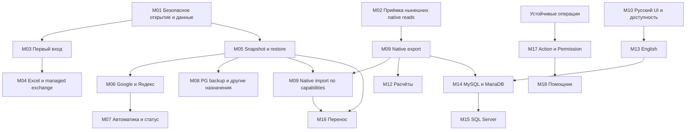

# Единый полный план SmartSQL

Обновлён **16 октября 2026** по всей согласованной истории, T01–T25, текущему коду, поставкам и аудиту входа/облачного восстановления. Это **единственный канонический порядок выполнения** для основного агента, субагентов и продолжения в другом чате. Будущие функции ниже не считаются реализованными.

## 1. Как пользоваться планом

1. Читать этот файл, [HANDOFF](HANDOFF.md), [TASKS](TASKS.md), `AGENTS.md`, затем проверять Git status/history. Не начинать реализацию только по последнему сообщению или старому отчёту агента.
2. **T01–T25** — постоянные номера задач GitHub, не перенумеровывать. **M01–M18** — этапы исполнения этого плана. **M01.01** и подобные обозначения — конкретные подзадачи. Исторические Stage 0–15/N0–N6/A–G — прежние группировки, не альтернативная очередь.
3. Для среза отдельно фиксировать код/автотесты, независимое ревью, ручную UI-приёмку и поставку. «Код готов» не означает «пользовательский сценарий принят» или «установщик проверен».
4. Основной агент выбирает ближайшую незавершённую подзадачу с выполненными зависимостями. Сейчас это **M01.02 — полная совместимость managed-формата и проверяемая защита upgrade**; M01.01 прошёл код/автотесты, его UI gate остаётся открыт. M02 идёт параллельно при доступной экранной проверке.
5. Перед параллельной реализацией зафиксировать контракт, владельцев файлов и условия интеграции. Не поручать нескольким агентам переписывать один файл.
6. После каждого проверенного среза обновлять статус конкретной подзадачи, матрицу, HANDOFF и существующие GitHub-задачи; коммитить/публиковать и подтверждать удалённый SHA. Не дублировать весь план в отчётах.
7. Если внешний инструмент недоступен, оставлять соответствующую приёмку открытой и продолжать независимый разрешённый код. Проверки интерфейса нельзя заменять утверждением о прохождении unit tests.

## 2. Цель, аудитории и обязательные границы

SmartSQL — универсальный понятный клиент структурированных данных в направлении DBeaver: локальные проекты, обычные существующие базы, таблицы/запросы/структура, безопасные операции, обмен, копии и перенос. Дипломная педагогическая практика проверяет универсальность; студенты/организации/практика не становятся сущностями ядра.

Уточнение пользователя 16 октября: продукт **автоматизирует и упрощает работу поверх существующих СУБД, снижая порог входа**. Собственный движок хранения, оптимизатор, менеджер транзакций или заменяющий PostgreSQL/SQLite сервер не разрабатываем. Используем готовые движки/драйверы/официальные средства; наши адаптеры, проверки и UI управляют ими. Managed-метаданные не навязываются обычной БД. Локальная работа не требует AI/облака, прямое подключение к серверу не требует backend SmartSQL. Это закрепляет принятую архитектуру (D052), не добавляет этапов и не меняет очередь M01.01.

Для каждой новой функции указывать: какую пользовательскую задачу упрощает; какой движок/библиотека/сервис исполняет операцию; что нужно для запуска; как показаны результат, ошибка и восстановление. Не воспроизводить готовую внутрянку СУБД ради числа функций.

### 2.1. Пользовательские пути

| Кто пришёл | Целевой путь | Обязательное объяснение |
| --- | --- | --- |
| Использует PostgreSQL/SQLite | Открыть существующую базу без преобразования, сначала просмотр | GUI другой программы необязателен. Сервер PostgreSQL продолжает работать там, где находится БД; к удалённому серверу локальная установка не нужна. |
| Знает СУБД, ничего не установлено | Локальный проект либо помощь в выборе/установке сервера | SQLite уже в SmartSQL; локальная работа не требует сервера. Для команды — отдельный PostgreSQL и официальная инструкция. |
| Пользовался только Excel | Книга/CSV → понятный preview → новый локальный проект | SQL/администрирование не требуются; исходник не меняется; путь, сохранение и копии понятны. |
| Один человек офлайн | Полная локальная работа; копии отправляются после появления связи | Облачный аккаунт не обязателен; офлайн-очередь не называется доставленной копией. |
| Несколько пользователей | Общий PostgreSQL и отдельные роли либо явно поочерёдная передача снимков | Облачная папка не предоставляет одновременную транзакционную запись в SQLite. |
| Корпоративный пользователь/аналитик | Ограниченные права, TLS, утверждённый сетевой маршрут/место данных | Доступ к чтению не означает разрешение загружать данные в личное облако. |
| ПК без D:/SDK/admin, несколько ПК, доступность | Подготовленная автономная поставка, устойчивые данные, перенос/восстановление | D: — правило нашей разработки; отдельная product-policy не должна требовать такой диск у каждого пользователя. |

MySQL/MariaDB и SQL Server — будущие провайдеры. Access/иные форматы не объявлять поддержанными по расширению файла. Публичные ссылки на СУБД вести на проверенные официальные страницы; GitHub использовать для подтверждённых официальных проектов/поставок.

### 2.2. Архитектура и сохранность

- Domain независим; Application зависит от Domain; Infrastructure реализует Application/Domain; Desktop использует контракты и composition root. Циклов и зависимостей core от UI/СУБД нет.
- SQL, нативные права, транзакции, типы и получение метаданных — в Infrastructure. Непрозрачный SQL-текст в Application допустим для существующих read-only запросов/показа определений, не для неограниченного исполнения моделью.
- Managed `IDataWorkspace` и ordinary native browser/editor — разные сценарии. GUID и четыре managed-типа не навязываются внешней БД.
- Просмотр, UPDATE, INSERT, DELETE, schema change, SQL и backup — отдельные подтверждённые возможности. Возможность чтения/наличие ключа не даёт права записи.
- Не терять молча типы, точность, NULL/пустоту, даты/timezone, binary, ограничения и зависимости. До преобразования — отчёт, совместимый вариант, явное решение либо отказ.
- Сначала проверяемое восстановление/предзаписная защита, затем опасные изменения. Не повторять автоматически неизвестный COMMIT или конфликтную запись.
- AI позже и только через Action/Permission/валидацию/подтверждение/аудит. Ручной SQL пользователя и модель — разные границы.
- Технологии добавляются только под текущую конкретную задачу. Не менять Avalonia 12/.NET 10, направление зависимостей или принятые правила без решения в [DECISIONS](DECISIONS.md).
- Разработка, исходники, данные, кэши, тестовые файлы/копии/результаты — на D:. Главный workspace `D:\Code\SmartSQL`; ML полностью отдельно в `D:\Code\SmartSQL-model`. Установленные инструменты/глобальные настройки не менять.
- Календарного дедлайна нет. Не выдавать предположительные даты/проценты готовности за обязательства; полезные проверенные preview поставлять по этапам.

## 3. Проверенная исходная точка

Текущий срез **M01.01**: явные OpenExisting/CreateNew, read-only format preflight, создание без overwrite и ReadWrite без fallback. Debug **0 warnings/errors**, **638 passed/0 skipped** (1/129/469/39), **60 real PG facts**. 24 новых случая и контракт — [MANAGED_PROJECT_OPENING](MANAGED_PROJECT_OPENING.md). Полное независимое финальное review не выполнено после usage limit субагентов; новая UI-приёмка не выполнена из-за screen-tool initialization failure. Следующий кодовый срез — M01.02, текущая ручная проверка остаётся M02/T23.

Основа кода — `28a4bcbbaa97e7ac0eab6c4239aca51078a77ff9`; последняя публикация аудита до консолидации — `5cd35692c2c620d9cde1ec07c7806c65f0f94f1a`. Следующий HEAD сверять по Git, а не принимать эти исторические SHA за текущий.

Исторический полный Debug-прогон T12: **614 passed, 0 skipped, 0 warnings/errors**; Domain 1 / Application 129 / Infrastructure 445 / Desktop 39; **60 реальных PostgreSQL-фактов**. Это проверка T12, не тесты будущего onboarding/cloud. Документальная консолидация не меняет приложение и не создаёт новый результат тестов.

| Область | Что уже есть | Что не считать готовым |
| --- | --- | --- |
| Локальный SQLite-проект | Четыре типа полей, структура/CRUD, страницы, поиск/сортировка/AND-фильтры и пресеты, paste, одношаговая отмена ячейки, CSV/JSON/XLSX, local backup/restore | XLSX → новый проект, полная семантика empty/NULL, общий batch undo, безопасная смена типа, cloud |
| Общее окно | WorkspaceWindow, дерево, независимые native tabs/сеансы, одинаковые имена не смешиваются, закрытие отменяет загрузку | Полная lifecycle/accessibility/visual acceptance |
| Режим/тема | Явный Simple/Advanced, атомарная память, переключение без смены прав; Gray/Light, закреплённая кнопка темы рядом с режимом | Полная DPI/IME/Narrator-проверка всех экранов |
| Обычный SQLite | main tables/views, точные страницы/типизированные фильтры/native sort, UTF-8/UTF-16 browse, read-only default | Virtual/shadow, native INSERT/DELETE/DDL/general undo |
| SQLite single-cell UPDATE | Явный opt-in, подтверждённый PK/schema/raw row, BEGIN IMMEDIATE, обязательный проверенный prewrite backup на D: | Сложные constraints/triggers остаются защищёнными; ABA при возврате к тем же raw values не обнаруживается |
| PostgreSQL | Native browse/типизированные запросы, отдельные guarded single-cell UPDATE и single-row INSERT/DELETE | Любой входящий FK пока блокирует DELETE; массовые операции/общая отмена/схема/backup ещё отсутствуют |
| T11 SQL | Read-only provider-native single statement, независимые сеансы, точные ограниченные результаты, cancel/drain, история 30 успешных запросов, UTF-8 .sql, редактируемая подсветка | SQL-write/manual transactions/параметры/completion не добавлены; SQLite SQL пока UTF-8, некоторые columnless CTE ограничены |
| T12 структура | Поля, собственные constraints/indexes/native definitions, полнота/unknown, порядок FK/термов, чтение сохраняет handles при успехе | Incoming FK/domain constraints/dependency graph/ER/DDL-editor вне первого охвата; SQLite structured sections Partial |
| Поставка/бренд | S-эмблема в ресурсах/EXE/окнах, self-contained Windows x64 EXE/ZIP, manifest/SHA, версии рядом с исходниками | Installer, public release/signing/update acceptance, Alt+Tab/Task Manager/все DPI и другие ОС |
| Аудит входа/облака | Код и официальные источники проверены с тремя агентами; Google/Яндекс и auto backup/restore подтверждены пользователем | Ни OAuth регистрации продукта, ни cloud delivery/автоматика/restore acceptance не реализованы |
| ML | Отдельный workspace, собственные scripts/config, 9 прежних stub-тестов | Реальная модель/обучение/интеграция не подтверждены; remote ML не объявлять опубликованным без проверки |

Последняя чистая поставка: `D:\Code\SmartSQL-builds\0.7.0-preview.6\win-x64-self-contained-verified-t12-28a4bcb\app\SmartSQL.Desktop.exe`. SourceDirty=false, 237 payload-файлов проверены; ZIP SHA-256 `236a17e2c089f8c0f2664f3058cfdfc56a6cb1735b569fe79c2fb81aab1578f3`. Новая Release UI-приёмка этой версии не заявлена. ISCC на последней проверке отсутствовал; installer не собран.

Ручная приёмка частичная: режим/память, поиск, изоляция одноимённых SQLite-вкладок/страниц, часть клавиш/отключения, T09-фильтр, один SQLite UPDATE/копия/CHECK-запрет, часть SQL/тем/отмены. Остаток хранится в [WORKSPACE_UI_ACCEPTANCE](WORKSPACE_UI_ACCEPTANCE.md). Инструмент экрана не инициализировался; это внешний блокер новых экранных проверок, не доказательство дефекта приложения и не повод закрыть пункты.

## 4. Порядок этапов и зависимости

Ниже — основной порядок по новому приоритету пользователя. M02 и M10 сопровождают каждую UI-функцию; M11/T25 — каждый поставляемый срез. Безопасный локальный экспорт M09 можно вести параллельно cloud после его собственных зависимостей, без ожидания всех будущих серверных backup/transport функций.

| Этап | Результат | Зависимость | Начальный статус |
| --- | --- | --- | --- |
| M01 | Безопасное open/create и устойчивые данные | Текущая база, отдельное решение product storage | M01.01 код/автотесты готовы; следующий M01.02, UI открыт |
| M02 | Остаток приёмки существующих PG/SQLite/SQL/инспектора | Рабочий экран/синтетические D:-данные | Частично; открыт |
| M03 | Первый полезный вход/recents/помощь выбора | Open/create M01; новый restore flow после M05 | Не реализован |
| M04 | Excel/CSV → новый проект и честный импорт | M01/M03, решение empty/NULL | Managed-основа есть; новый срез не сделан |
| M05 | Общие локальные snapshots/restore/catalog/outbox | M01, фактический provider scope | Локальные copy primitives есть; общий pipeline не сделан |
| M06 | Google Диск и Яндекс Диск | M05 + регистрации/тестовые аккаунты | Не реализованы; два адаптера можно параллельно |
| M07 | Автокопии/быстрый статус/retention/recovery | M05/M06 | Не реализованы; обязательная часть cloud-цели |
| M08 | PostgreSQL backup и следующие назначения | M05; дополнительные транспорты после двух первых | Не реализованы; не блокирует первый SQLite cloud slice |
| M09 | Native export → native import/paste | Стабильные reads/T09/T11, recovery, отдельные write capabilities | T13/T14 не реализованы |
| M10 | Полный русский UI, плавность и доступность | Сквозной; финальный проход после включённых функций | Частично, не принят целиком |
| M11 | Проверенная поставка, onboarding/team docs, диплом | M01 и приёмка включённого scope | EXE/ZIP есть; installer/release gates открыты |
| M12 | Расчёты и простые графики | T09 + M09 export/result scope | Не реализованы |
| M13 | Полный English | Стабильные русские PG/SQLite workflows/M10 | Не реализован |
| M14 | MySQL и MariaDB | Стабильные PG/SQLite + M09, минимальная локализация | Не реализованы |
| M15 | SQL Server | M14 + та же provider acceptance | Не реализован |
| M16 | Связи, schema/type changes, перенос и расширенные операции | Нужный расширенный metadata scope + M05/M09 | Отдельные managed primitives есть; полный scope нет |
| M17 | Action/Permission и аудит | Устойчивые desktop/provider operations | Не реализован |
| M18 | Локальный помощник | M17, устойчивый desktop, отдельная ML-подготовка | Эксперимент изолирован; интеграции нет |

### M01. Безопасное открытие и устойчивое хранение

Связь: T23/T24/T25, аудит P0. Это ближайший реализационный этап.

- [x] **M01.01 Open/Create (код/автотесты; ручная UI-приёмка отдельно открыта):** отделить создание нового managed-файла от открытия существующего. Существующий open не создаёт файл/служебную схему. Пустой/foreign SQLite направляется в native path или получает понятный отказ; managed подтверждается форматом/версией, не одним расширением/произвольным совпадением имени таблицы.
- [ ] **M01.02 Совместимость:** явно обработать legacy/current/future/corrupt managed schema. Будущий формат не открывать на запись; необходимый upgrade существующего проекта предваряется проверенной копией и понятным сообщением.
- [ ] **M01.03 Product storage decision:** зафиксировать в DECISIONS installed/portable режимы, устойчивый root данных/preferences/копий/каталога/очереди/temp и единый контракт EXE/launcher. Правило D: разработки сохраняется; поддержка чужого ПК без D: — отдельная product-policy, не скрытый перенос среды на C:.
- [ ] **M01.04 Запуск/обновление:** новая версия и разные способы запуска находят тот же выбранный root; бинарники и пользовательские файлы разделены. Portable имеет явную политику; недоступный/неверный root не заменяется молча новым пустым проектом.
- [ ] **M01.05 Copy-first migration:** предложить пользователю подтверждённый старый путь; live SQLite копировать согласованным способом, проверять целостность/версию/размеры/hashes; несколько кандидатов не выбирать произвольно. Исходники сохранять; конфликтующее назначение не затирать. Не сканировать чужие аккаунты/диски без согласованного scope.
- [ ] **M01.06 Ошибки и гонки:** отсутствие прав/места, read-only directory, файл исчез/заменён между выбором и open, уже существующее имя при create, длинный/Unicode path, ссылки/reparse points и собственная DB/WAL/journal как destination получают безопасный исход. Ошибка раннего startup показывается понятно, без незаметного fallback.

Готово: synthetic empty/ordinary/managed/missing/corrupt/future файлы проверены до/после; open не меняет чужую схему и не создаёт отсутствующий файл. Create/upgrade отменяемы в заявленных границах, нет частичной активной БД. Обновление/переустановка/EXE/launcher не теряют доступ к проекту. Миграция копирует и проверяет, не удаляет оригинал. Решение product-path записано до реализации зависимых адаптеров.

### M02. Завершение приёмки уже существующих функций

Связь: T01–T04/T06–T12/T23. Цель — принять нынешний scope, не переписать его и не расширить права ради теста.

- [ ] **M02.01 PG writes:** single-cell UPDATE, single-row INSERT/DELETE; NULL/empty/пробелы/границы чисел, required/default/identity/sequence, ограничения и отдельные права. Изменённая/удалённая другим writer строка — конфликт; успешный commit с failed refresh — отдельный результат; неизвестный COMMIT без автоповтора.
- [ ] **M02.02 Workspace:** два PG/SQLite соединения с одинаковыми именами объектов; повторное открытие; независимые страницы/поиск/сортировка/выделение/SQL; close/disconnect одного не ломает остальных; горячие клавиши/мышь.
- [ ] **M02.03 T09:** сочетания typed AND/поиска/native sort до пагинации, NULL/empty, отказ несовместимого типа, восстановление после ошибки, переключение режима/страниц/вкладок без потери условий.
- [ ] **M02.04 T10:** native SQLite opt-in, одна ячейка, raw/schema conflict/external writer, границы значений, обязательная backup, отказ копии без UPDATE, cancel/close в copy/write, failed refresh после успеха, изоляция вкладок. Не заявлять INSERT/DELETE/ABA detection/general undo.
- [ ] **M02.05 T11 data:** PG UI и несколько независимых SQL-вкладок; native types/точность/NULL/full value/копирование, предел строк и полной SQL UTF-8 длины, timeout/cancel/recovery. Сохранение SQL/results при смене темы/режима.
- [ ] **M02.06 T11 files/lifecycle:** open/save/cancel/существующий .sql path, отсутствие silent truncation/autorun; native picker требует явного завершения перед close/disconnect/shutdown; выполняющийся запрос отменяется/drains до release; повторное закрытие и cleanup error честны.
- [ ] **M02.07 T11 editor:** caret/selection/copy/paste/undo/IME, подсветка/предельный SQL, минимальное окно/DPI/клавиатура/Narrator. Подсветка не переписывает SQL и не является security parser.
- [ ] **M02.08 T12:** четыре секции, full text/copy/scroll, quoted/длинные имена, Partial/Unavailable/unknown и object-owned scope понятны; handles сохраняются после успешного просмотра; модальное окно закрывается с владельцем, cancel/close/disconnect/drain; обе темы/режимы.
- [ ] **M02.09 Regression:** first-run/повреждённые preferences/выбор позже, Simple/Advanced и Gray/Light сохраняются отдельно; текущая запись и permissions не меняются от режима/темы; native caption buttons доступны.
- [ ] **M02.10 Managed foundation regression:** create/open/reopen проекта; добавление/переименование/защищённое удаление таблиц/полей; record/cell CRUD; pagination/search/sort/AND и saved filter presets; Excel paste/одношаговая отмена; нынешний CSV/JSON/XLSX обмен и local backup/restore. Проверять неизменность нецелевых данных. Этот gate обязателен также после затрагивающих его M01/M04/M05 изменений, до позднего дипломного happy path M11.

Готово: все соответствующие пункты WORKSPACE_UI_ACCEPTANCE подтверждены на конкретной версии/синтетических данных и отражены отдельно от автотестов. При отказе экранного инструмента остаётся точная запись «не выполнено»; независимые M01/M03/M05/M09 продолжаются, но release gate ручной приёмки не пройден.

### M03. Первый полезный вход, возврат к данным и выбор СУБД

Связь: T08/T23/T24; зависимости M01.01/контракт устойчивого хранения.

- [ ] **M03.01 Welcome:** действия «Начать из Excel/CSV», «Создать локальный проект», «Открыть существующую базу/проект», «Восстановить из копии», пример и помощь выбора. Подключать только реально работающие потоки: новый restore завершается после M05, остальные части welcome не обязаны его ждать. До выбора не создавать default user DB. Сохранить явный Simple/Advanced и его память, встроить его в понятный поток.
- [ ] **M03.02 Recent/data discovery:** тип источника, полный путь/endpoint без секретов, недавние проекты/несекретные профили, «Где мои данные», «Показать каталог копий». Отсутствующий файл не создавать; недоступный сервер не скрывать как пустой проект.
- [ ] **M03.03 Existing DB:** определить SQLite/managed/скрипт/книгу до write, показать фактическую БД/схему/чтение или разрешённую запись; не переносить и не ставить сервер автоматически.
- [ ] **M03.04 Expert without DB:** объяснить встроенный local SQLite и выбор общего PostgreSQL; server/client/GUI/driver различаются. Для каждого реально поддержанного движка — официальный сайт, downloads, требования/поддержанная матрица и короткая инструкция подключения.
- [ ] **M03.05 Corporate/offline:** инструкция endpoint/роль/TLS/CA/сетевой доступ без снижения защиты из-за сертификата; неподдержанные SSO/tunnel/cert scenarios явно обозначены. Локальная работа без обязательной регистрации/сети.
- [ ] **M03.06 Возврат после первого успеха:** показать созданный путь, как снова открыть, что осталось исходником Excel, где копии и что будет при обновлении. Перенос между ПК и восстановление — понятные отдельные действия.

Готово: новичок без SQL/СУБД и опытный пользователь с существующей БД проходят разные короткие сценарии; отмена первого экрана не создаёт проект. Каталог будущих СУБД не выглядит рабочей кнопкой подключения. Recents не сохраняют пароли, SQL-тексты или содержимое данных.

### M04. Excel-first и симметричный managed-обмен

Связь: managed CSV/JSON/XLSX/clipboard, T23/T24; подготовка T14. Зависит от M01/M03 и решения о representability пустых значений.

- [ ] **M04.01 Единый master:** XLSX/CSV → новый проект/таблица; выбранный лист/диапазон/заголовки, имена/тип каждого поля, новый путь. Несколько листов не объединять/отбрасывать молча. Имеющийся CSV new-table сохранить и привести к тому же потоку.
- [ ] **M04.02 Честный preview:** исходное → будет сохранено, тип/ошибка/предупреждение, scope/число строк и пропущенных колонок. Date/Boolean/Number normalization не скрыта за raw samples; подтверждение отдельно от настройки.
- [ ] **M04.03 Идентификаторы и точность:** safe default Text для кодов; leading zeros/длинные числа/Excel display formats/десятичные локали/date-time/timezone разобраны до commit. Уже потерянную Excel точность не обещать восстановить.
- [ ] **M04.04 Empty/NULL:** отдельно решить совместимость текущего FieldValue и проекта для NULL/empty/whitespace. До изменения core-семантики — DECISIONS, тесты и версия/путь миграции; пока значение непредставимо, явный отказ/согласованный результат, не молчаливая подмена.
- [ ] **M04.05 CSV intake:** явные encoding/delimiter/header и preview. UTF-8 strict сохранить; Windows-1251/TSV/файл без заголовка поддерживать отдельными проверенными вариантами либо отказывать с точной причиной. Повреждённые байты не заменять.
- [ ] **M04.06 XLSX safety:** формулы/макросы/ошибки/защищённые книги/неподдержанные значения не исполнять/не угадывать. Объяснить выбранный data-only scope; оформление/формулы не выдавать за перенесённые вычисления.
- [ ] **M04.07 Existing-table import:** явно append, duplicates и число новых строк. Отмена/ошибка = атомарный отказ; перед ошибочно успешным batch есть именованная копия/проверенный restore либо безопасный batch undo. Replace/upsert только отдельным срезом с ключами/preview.
- [ ] **M04.08 Limits/symmetry:** bounded parsing/preview, progress/cancel, большие строки/Unicode/пустая таблица/дубли заголовков/пустой лист. CSV/JSON/XLSX export/import сохраняют заявленные различия либо раскрывают несовместимость; CSV formula-safety не называется byte-identical backup.
- [ ] **M04.09 Output conflicts:** create-new/атомарный publish; существующий файл не затирать молча. Предложить другое имя/timestamp/отмену; explicit replace требует отдельной восстановимой политики.

Готово: synthetic workbook/CSV с несколькими листами, `00123`, большими числами, датами, formulas, NULL/empty/whitespace проходит предсказуемо; исходный SHA неизменен. Cancel/error не меняет destination; round-trip и восстановление ошибочного batch проверены. Нет потери столбцов/строк/возможностей без сообщения.

### M05. Общая основа проверенных копий и восстановления

Связь: T20/T24/T25; зависимости M01 storage и достоверный provider scope. Существующие managed backup/T10 prewrite используются как база, не выдаются за готовую общую систему.

- [ ] **M05.01 Контракт и scope:** различать local managed project, ordinary SQLite snapshot, PostgreSQL single-DB dump, экспорт таблицы и SQL-result. Указать, что включено/исключено; export не называть полной копией. Общие контракты малы, provider-specific операции остаются Infrastructure.
- [ ] **M05.02 SQLite snapshot:** Online Backup API для активного WAL/внешнего writer; новый локальный temp, предел времени/размера, отмена, проверка целостности/схемы/версии и завершение в отдельный immutable-by-application файл. Не переносить live `.db`/WAL разрозненной файловой копией и не делать checkpoint исходника ради cloud.
- [ ] **M05.03 Manifest/catalog:** ограниченный формат/версия, snapshot/project/source ID, provider, scope, времена, размеры/checksums/сведения совместимости; никаких credentials/SQL-history/cache. Неполный артефакт не появляется как готовая копия; publish атомарен, коллизии не перезаписывают старое.
- [ ] **M05.04 Restore in new target:** загрузка/проверка/совместимость/целостность/открытие сначала в новом локальном файле. Замена активного проекта — отдельное подтверждение и защитная копия. Временная работа не меняет оригинал; повреждённая/будущая версия не принимается.
- [ ] **M05.05 Каталог пользователя:** «Мои копии», scope/источник/путь/время/размер/проверка, найти/показать/открыть/восстановить. Не путать prewrite safety copy, manual point и scheduled snapshot. Предзаписная T10-копия до UPDATE не является облачной копией уже изменённого состояния.
- [ ] **M05.06 Durable outbox:** snapshot ID и конкретные destination/account ID, состояния/попытки/ошибки/последний verified object. Очередь переживает crash/restart, один источник не подменяется другим по совпадению имени; повтор после потерянного ответа сначала проверяет существующую доставку.
- [ ] **M05.07 Security/limits:** ограничить parsing/download/extraction, path traversal/zip bombs; защитить ссылки/credentials, исключить из transferable artifact. Решить формат шифрования, хранение/перенос/восстановление ключа до обещания encrypted backups. Использовать готовую проверяемую криптографию, не собственную.
- [ ] **M05.08 Local failure acceptance:** WAL/конкурентная запись, empty/UTF-16/BLOB/Int64, cancel/kill/restart, disk full/нет прав/путь изменён, битая копия, восстановление без исходного WAL, повторные имена, старый/новый формат и schema version.

Готово: воспроизводимо создаётся согласованный артефакт и **фактически восстанавливается** с проверкой схемы/значений. Общая локальная копия/очередь работает без облака и не раздувает диск бесконтрольно. Дизайн отделяет подтверждённый commit, snapshot, remote delivery и restore. PG при первом SQLite-срезе честно помечен отдельной ещё не реализованной возможностью.

### M06. Google Диск и Яндекс Диск — первые назначения

Связь: T20. Зависимости M05, стабильный storage/auth contract и зарегистрированные OAuth-приложения. После фиксации общего контракта адаптеры можно делать параллельно с непересекающимися файлами.

- [ ] **M06.01 Общие правила:** пользователь явно подключает один или оба аккаунта/назначения и выбирает scope данных. Для организации подтверждается допустимость копирования. Соединение к Codex Drive не используется как авторизация SmartSQL; секреты не запрашиваются в чате.
- [ ] **M06.02 Google auth/location:** registered installed-app OAuth через системный браузер/PKCE/state/callback, минимальный `drive.file` для видимой созданной приложением папки; consent/необходимые public verification и устойчивая identity приложения. Hidden appDataFolder не единственное хранилище восстановимых пользовательских копий.
- [ ] **M06.03 Google transfer:** бинарные snapshots без конвертации в Docs/Sheets; resumable upload/восстановление accepted range, expired session, idempotent snapshot ID и явное завершение. Проверка remote ID/размера/доступной сильной checksum либо контрольного скачивания; имя/modifiedTime не идентичность.
- [ ] **M06.04 Google recovery:** листинг своих версий, download/verify/restore, другой аккаунт/отозванный доступ/повторный вход/переустановка/новый ПК. Проверить доступ к прежним копиям с выбранным OAuth scope; предусмотреть ручное получение видимого архива через обычный Drive.
- [ ] **M06.05 Яндекс auth/location:** официальный OAuth/REST; проверить точный native flow, callback и минимальную app-folder capability, `app:/` list/upload/download/delete именно ограниченным токеном. Debug token не production UX; невозможность требуемого flow не обходить паролем/cookies/неофициальным web API.
- [ ] **M06.06 Яндекс transfer/recovery:** upload URL/PUT, новые версии без overwrite, безопасное обращение с чувствительным URL, корректное асинхронное завершение. Подтвердить metadata/checksum/resume свойства реальным протоколом; неизвестное не угадывать, при необходимости download+SHA-256. Проверить восстановление app-folder на другом ПК/после переавторизации.
- [ ] **M06.07 Transport acceptance обоих:** до/во время/после upload, потерянный финальный ответ, quota/размер, expiry/revoked token, timeout/cancel/close/restart, hash mismatch/удалённый объект, два устройства/одинаковые имена. Исходник/последняя копия сохраняются; нет ложного green status.
- [ ] **M06.08 Credentials:** защищённое отдельное хранилище; access/refresh tokens, app passwords и resumable URLs не попадают в logs/settings export/backup. Disconnect отключает доступ, не удаляет пользовательские локальные данные/историю копий; remote deletion отдельно подтверждается.

Готово: каждый сервис отдельно проходит auth → create/upload → remote verification → download → restore на разрешённом synthetic test account. Успех одного не закрывает второго. Официальные API/условия повторно сверяются при реализации: аудит фиксировал их на 16 октября, не даёт вечной гарантии будущих версий/тарифов. Ручная кнопка upload сама по себе не закрывает auto-backup требование M07.

### M07. Автокопирование, быстрый доступ и честные статусы

Связь: T20/T23. Зависимости M05/M06 и решение schedule/retention/outbox.

- [ ] **M07.01 Persistent cloud access:** постоянная кнопка/статус в оболочке рядом с темой/режимом, доступная на minimum size без вытеснения уже закреплённых controls. Одно нажатие: назначения/аккаунты, scope, последняя копия, «Сделать сейчас», «Восстановить», прогресс/ошибка/повтор/настройки.
- [ ] **M07.02 Статус:** отдельно «Сохранено на компьютере» или «На сервере», «Локальная копия проверена», «Google verified: время», «Яндекс pending/error», «Restore проверен». Указать возраст/scope, при неизвестном COMMIT не показывать success. Отсутствие cloud-настройки/сети/места/доступа — понятные самостоятельные состояния.
- [ ] **M07.03 Scheduling:** выбранный интервал/изменения, debounce/rate limits, одна согласованная работа на источник, контроль размера/места. Сохранение ячейки не ждёт сеть; snapshots не создаются бесконечно на каждую клавишу/внешний polling event.
- [ ] **M07.04 Offline/restart:** durable queue, ограниченный retry/backoff, safe resume и catch-up после запуска. Потерянный ответ не порождает дубликаты; локально несохранённая операция не становится cloud snapshot. Время копии не означает включение всех последних транзакций других приложений.
- [ ] **M07.05 App lifetime:** первый вариант автоматичен **при запущенном SmartSQL**. Закрытие сохраняет очередь/cancels/drains. Работа закрытого приложения требует отдельной явно включённой службы/планировщика, угроз/credentials/lifecycle tests и решения; не устанавливать скрыто и не обещать заранее.
- [ ] **M07.06 Retention:** видимая политика версий/объёма/ручных точек, bounded outbox и согласованный coalescing. Нет общего mutable latest.db/last-writer-wins; не удалять последнюю проверенную/защищённую пользователем/единственную ещё не доставленную копию молча. Удалять только свои версии по выбранным правилам.
- [ ] **M07.07 Два устройства:** разные snapshot/device generations, сохранить обе ветки и показать конфликт. Восстановление/последовательная передача — отдельный workflow; никакого автоматического merge SQLite.
- [ ] **M07.08 End-to-end acceptance:** offline → локальная работа → закрытие → запуск → доставка в оба сервиса → восстановление на другом устройстве; quota/revoked access/hash mismatch/crash/cancel; один cloud error не скрывается вторым success, история состояния доступна без секретов.

Готово: Google и Яндекс работают автоматически в заявленном режиме и имеют простой проверенный restore; пользователь понимает, где сохранены изменения, где проверенная копия и что ожидает отправки. Нет обещания постоянной доступности сети/провайдера. Локальная работа без cloud по-прежнему доступна.

### M08. PostgreSQL backup и следующие назначения

Связь: T20/T24. PG срез зависит от M05; дополнительные транспорты расширять после двух приоритетных облаков. PG backup можно исследовать/реализовывать параллельно M06/M07 при отдельных файлах, он не превращается в незаметное обязательное условие первого local SQLite slice.

- [ ] **M08.01 PG scope/tooling:** определить заявленную single database/schema scope, globals/roles/extensions/external dependencies и ограничения. Проверить выбранные `pg_dump`/`pg_restore` версии/сервер, доступ/права/RLS/совместимость; утилиты не считать уже включёнными в self-contained EXE. Официальная установка/обнаружение отдельны от connection UI.
- [ ] **M08.02 PG dump:** согласованный provider-specific artifact, progress/cancel/timeout/exit code/warnings и итоговая проверка. CSV/перебор отдельных несогласованных страниц/копия живого server directory не подмена backup. Credentials не в аргументах/логах/архиве; отсутствие полномочий не обходить требованием superuser каждому клиенту.
- [ ] **M08.03 PG restore:** изолированная новая БД/проверенный сервер и полномочия; schema/types/PK/FK/indexes/sequences/данные/права заявленного scope сверяются. Dump исполняет код источника: чужой архив не autorun в production от superuser. Нет обещания всего cluster/PITR/production recovery только на основании pg_dump.
- [ ] **M08.04 Cloud PG:** готовый dump проходит те же каталог/очередь/transfer/verify/restore и статус M05–M07. До этого cloud UI на PostgreSQL честно сообщает доступный scope. У организации остаётся собственная серверная backup-стратегия; desktop не единственная защита production.
- [ ] **M08.05 Mail:** официальный WebDAV/пароль приложения — кандидат следующего адаптера. Проверить условия аккаунта, ограничения, auth/size/cancel/resume/conditional writes/list/download/remote verification/restore; обычный пароль и неофициальные cookies/REST endpoints не использовать.
- [ ] **M08.06 Other destinations:** готовый snapshot в локальную/cloud-sync/network папку или личный сервер через отдельно выбранный проверенный протокол. «Файл записан в sync folder» не означает «облако подтвердило». Универсальная поддержка любого облака/WebDAV не обещается; adapter capabilities/неподдержанное явно видны.

Готово отдельно по каждому provider/destination: заявленный snapshot восстановлен и проверен, отказ не повреждает источник/последнюю копию, scope и недоступные функции понятны. M08 не добавляет отдельный SmartSQL server и не повышает write permissions.

### M09. Обмен с внешними таблицами и SQL-результатами

Связь: **T13 → T14**; сохраняет прежнюю очередь. Локальный экспорт не требует OAuth/готовности Mail/PG backup; его можно вести параллельно M06–M08 после стабильных read contracts и файлового pipeline.

- [ ] **M09.01 Export scope:** полная таблица, текущая выборка/фильтры, страница или **уже показанный ограниченный SQL-result** — разные явные варианты. Truncated result не выдавать за полную таблицу. Повторное выполнение SQL не делать скрыто под экспортом имеющегося результата.
- [ ] **M09.02 Type/format contract:** native type/ordinal/NULL/empty/whitespace/точные большие числа/decimal/date/time/timezone/BLOB/Unicode/длинные значения/пустая таблица; CSV/JSON/XLSX границы, formula-safe Excel output, необходимость metadata/escaping и обратного чтения. Лишённый информации формат сопровождается явным отчётом.
- [ ] **M09.03 Native streaming export:** read-only согласованный snapshot заявленного scope, bounded memory/backpressure, progress/cancel/limits, temp+atomic create-new output. Последовательные нынешние страницы — отдельные snapshots; не называть их одним согласованным экспортом без нового provider механизма.
- [ ] **M09.04 Export verification:** обратное чтение/сверка типов и значений или формальный список невыразимого; permission/error/disk full/cancel/external writer, CSV formula/injection-shaped text. Закрыть T13 отдельно от T14.
- [ ] **M09.05 Import preview:** mapping фактических полей, типы, defaults/identity/generated, NULL/value/server default, exact conversions, scope/число строк, append/duplicates/ключи. До write выявить несовместимое; окно показывает «будет сохранено», исходник не меняется.
- [ ] **M09.06 Provider batch writes:** отдельные INSERT/возможности/права, schema/constraint/trigger guards, согласованный транзакционный batch, cancellation/rollback/unknown COMMIT, восстановимость. Single-row PG INSERT не доказательство массовой atomicity. Native SQLite INSERT пока нет: поддержать отдельный guarded slice M16.04 либо оставить явный отказ; не обходить через unlimited SQL.
- [ ] **M09.07 Clipboard symmetry:** Excel paste использует тот же mapping/validation/preview/atomic batch, а не отдельный менее безопасный путь. Append по умолчанию явно виден; replace/upsert — отдельный подтверждённый scope, не скрытое расширение.
- [ ] **M09.08 Import acceptance:** constraint/permission/schema change/concurrent modification/precision loss/ошибка на середине/kill/cancel/двойной запуск/failed refresh after success; источник и destination не остаются молча частично изменёнными. Определить границы атомарности заранее, без обещания межсерверной распределённой транзакции.

Готово: каждый заявленный формат/provider проходит scope → export → проверку → import/сверку; неподдержанное понятно до записи. T13 можно выпустить раньше T14; готовность managed imports не считается готовностью native batch. Основа пригодна M12/M16 без vendor lock-in.

### M10. Полный русский UI, плавность и доступность

Связь: T23/T04, часть T07/T08/T11/T12. Сквозной этап: проверять после каждой функции; отдельный итоговый проход нужен перед заявлением принятой русской версии.

- [ ] **M10.01 Полный список экранов:** shell/welcome/tree/tabs, managed grid/constructor/filters/paste/undo, native browse/edit/insert/delete, SQL/history/files/full value, inspector, connections, import/export preview, copy/restore/cloud/settings и все ошибки/пустые/загружаемые состояния.
- [ ] **M10.02 Layout:** единая сетка, высоты/отступы/плотность/шрифты; длинные русские подписи/paths/headers не скрывают смысл/кнопки. Сворачиваемый inspector, usable scroll/splitter, normal/min window, resize и большое число вкладок.
- [ ] **M10.03 State/transitions:** переключение вкладок/режимов/тем/панелей/загрузки без скачков/мерцания/потери поиска, фильтров, страницы, selection, SQL text/result/caret. Плавность не задерживает работу и не требует декоративной анимации/новых библиотек; доступное поведение без лишнего движения.
- [ ] **M10.04 Themes/caption:** Gray и Light, память отдельно от режима, закреплённые theme/mode controls и доступ к копиям. Проверить все dialogs/menus/disabled/selected/error/warning/NULL состояния и контраст; OS minimize/maximize/close остаются работоспособны. Не возвращать прежний единственный светлый вариант.
- [ ] **M10.05 Keyboard/focus:** Tab/Shift+Tab/Enter/Escape/Ctrl+Tab/Ctrl+W/Ctrl+Enter, copy/select, возврат фокуса после диалога, видимое выделение и caret, IME. Read-only/disabled причины доступны клавиатуре; нет ловушек фокуса.
- [ ] **M10.06 Accessibility:** normal/minimum, 100/150/200% DPI, High DPI между мониторами при доступной среде, Narrator/automation names/roles, сообщение прогресса/ошибок. NULL/пустота/запрет обозначены текстом, не только цветом; полное значение доступно при display trimming.
- [ ] **M10.07 Honest actions:** будущих неработающих кнопок нет; доступность соответствует provider permission/capability. Одинаковые действия имеют одинаковые подписи, понятные подтверждения, отмену и состояние результата; commit и refresh не смешаны.

Информационный контракт: Simple сохраняет все доступные повседневные table/record/cell операции, Excel/paste/import/export, поиск/фильтры/сортировку и поддержанную отмену; Advanced добавляет SQL/подробности/готовые расширенные инструменты, не отнимая базовые действия. Ограничения native provider действуют в обоих режимах. Группы «База/Подключения», «Данные», «Импорт», «Экспорт», «Структура», «Копии», «Настройки» согласованы; дерево слева, данные/SQL по центру, сворачиваемые подробности и нижний connection status. Каждая вкладка владеет object/page/query/loading/error state. Новый UI не прячет обязательную базовую функцию исключительно в Advanced и не сбрасывает это владение.

- [ ] **M10.08 Full acceptance:** реальные пользовательские пути от первого запуска до повторного открытия, copy/restore/export с клавиатуры в обеих темах/режимах. Список оставшихся дефектов с точной версией и шагами, без утверждения «всё принято» по одному скриншоту.

Готово: выполнен полный русскоязычный T23-проход по включённому scope и закрыты соответствующие M02-пункты. Замечание пользователя о неровном UI/переходах считается выполненным только после этого, не по наличию общего theme файла.

### M11. Постоянная поставка, установка, командные инструкции и диплом

Связь: T24/T25/T05. Публикация EXE/ZIP продолжается после проверенных кодовых срезов; installer/public release требуют собственных gates.

- [ ] **M11.01 Reproducible preview:** clean source commit, self-contained Windows x64, manifest source SHA/dirty/deployment/версии, payload/ZIP sizes+SHA; новый version/build ID под `D:\Code\SmartSQL-builds`, старые версии не перезаписывать. Данные/preferences/cache/credentials/DB/weights не входят в пакет.
- [ ] **M11.02 Runtime isolation:** EXE/launcher используют согласованную M01 product-policy; runtime/temp/cache не загрязняют immutable payload. Тестовая база отдельно от оригинала/репозитория, работа запущенной прошлой версии не теряет данные при новой публикации.
- [ ] **M11.03 Installer build:** продолжить существующий Inno Setup recipe, проверить фактический ISCC. При отсутствии сохранить исходники и точный blocker; не объявлять installer собранным и не устанавливать инструменты/менять глобальную систему скрыто.
- [ ] **M11.04 Install/update/uninstall:** изолированная разрешённая среда, без SDK/server/admin/D: по согласованной product-policy; shortcuts/app identity/иконки, первый запуск, upgrade с сохранением данных/preferences/backup, uninstall без удаления пользовательских файлов; interrupted/failed install и повтор. Все дополнительные полномочия/среды согласованы, dev-policy D: не нарушается.
- [ ] **M11.05 Branding:** сохранить предоставленную зелёную S-геометрию; executable/window/dialog/taskbar уже частично проверены. Довести Alt+Tab/Task Manager/shortcuts/installer/малые размеры/DPI/контраст. ICO/SVG/PNG согласованы; название SmartSQL во всех местах. Не генерировать новую марку без задачи.
- [ ] **M11.06 Distribution/trust:** README/инструкция первого запуска, известные ограничения, проверенные GitHub Releases/официальная точка скачивания, changelog, контрольные суммы. Решить подпись/сертификат; unsigned preview честно обозначать. Автообновление только отдельным проверенным срезом после доверия к пакетам/rollback/data safety; сначала ручное безопасное обновление.
- [ ] **M11.07 Team guide:** существующий подходящий ПК в LAN как PostgreSQL host, индивидуальные минимальные роли/TLS/маршрут/ответственный за uptime/backup; два SmartSQL клиента и конфликт/отказ/восстановление. Удалённо — утверждённый VPN/сервер по условиям владельца. Не обещать нулевые эксплуатационные затраты или готовый application server SmartSQL.
- [ ] **M11.08 Sequential low-cost guide:** один редактор, завершённая проверенная версия и явная передача следующему, новая локальная копия. Нет ложного distributed lock/merge/одновременной записи в sync SQLite; конфликтующие ветки сохранены.
- [ ] **M11.09 Other platforms:** Linux/macOS и иные архитектуры остаются целью выбранного Avalonia-подхода. Их собственные publish/native dependencies/path/credentials/backup/installer/accessibility checks и разрешённая среда должны быть определены отдельно; Windows-успех не сертификат других ОС. Не навязывать продукту D:-ограничение Windows на других системах.
- [ ] **M11.10 Diploma continuously:** synthetic студенты/группы/организации/места и сроки практики/статусы/документы моделируются обычными таблицами. Сквозной сценарий create/import/search/filter/update/export/backup/restore и объяснение архитектуры; демонстрационные данные/скриншоты/инструкция воспроизводимы, персональные данные отсутствуют. Метаданные документов/ссылки не обещают ещё не реализованный binary document-management subsystem.

Готово для конкретного выпуска: package проверен и запущен в заявленной среде, данные пережили update/uninstall/restore, scope/RU/UI/DB/platform acceptance честны, README/инструкция/ограничения доступны. Первый полезный релиз не ждёт всех будущих СУБД и AI. Local-only preview не называется завершённой cloud-версией; Google/Яндекс auto+restore принимаются отдельно.

### M12. Быстрые расчёты и простые графики

Связь: T15. Зависимости T09 и M09 export/result contract; импортный срез T14/M09.05–M09.08 нужен только конкретному сценарию поступления данных, не искусственное условие read-only расчётов.

- [ ] **M12.01 Scope:** текущий результат/выборка/таблица/страница явно названы; count rows и non-null values различаются, ограниченный SQL-result не полная БД.
- [ ] **M12.02 Arithmetic:** количество/сумма/среднее для подтверждённых типов и точности; unsupported/domain/binary/date правила явны, NULL корректен. Не заменять exact numeric на double молча.
- [ ] **M12.03 Charts:** небольшой практичный набор графиков по реально рассчитанным данным, подписи/единицы/пустота/слишком много категорий/лимиты/доступность; исходник не меняется.
- [ ] **M12.04 Reproducibility:** экспорт результата/графика с scope/условиями/временем; ошибки/отмена/внешний writer не выдают частичный расчёт за полный. Выбор chart-технологии только под этот реальный срез.

Готово M12: числа сверены с эталоном, точность и охват понятны, график не вводит пользователя в заблуждение и доступен на русском в обеих темах. English parity существующих расчётов/графиков — обязательная часть M13, а не блокирующее условие завершения более раннего M12.

### M13. Полный английский интерфейс

Связь: T16. После стабилизации и приёмки русских PostgreSQL/SQLite workflows; русские данные/ошибки БД/идентификаторы не переводятся как интерфейс.

- [ ] **M13.01 Catalog:** извлечь все UI strings, диалоги/errors/diagnostics/tooltips/empty/loading/confirmations/installer/docs labels в согласованный RU/EN механизм без лишней платформы.
- [ ] **M13.02 Parity:** совпадающие ключи, fallback/no missing keys, языковой выбор и память. При необходимости первый вариант применяет язык после restart, явно сообщая это.
- [ ] **M13.03 Data invariance:** локаль не меняет хранимые числа/даты/SQL/имена/NULL; формат ввода и canonical value объясняются. Нативные сообщения, которые нельзя перевести достоверно, корректно отделены.
- [ ] **M13.04 Acceptance:** весь сквозной сценарий RU и EN, длинные/короткие строки, DPI/клавиатура/Narrator/темы; никакой половины экрана на другом языке. После введения словарей новые функции сразу имеют обе версии.

Готово: полное совпадение функциональности/сообщений RU/EN, выбор сохраняется, документация и фактические labels согласованы.

### M14. MySQL и MariaDB

Связь: T17. Зависимости устойчивый PostgreSQL/SQLite, существующие native contracts/M09 и русская/английская UI-основа. Это два реально проверяемых движка, не одно предположение о совместимом протоколе.

- [ ] **M14.01 Matrix/driver decision:** официальные поддержанные версии/driver/auth/TLS/licensing/распространение, minimal current use case, отдельные synthetic fixtures и их безопасный запуск/stop. Не устанавливать серверы/инструменты глобально без разрешения.
- [ ] **M14.02 Connect/read:** профили без паролей, certificate/host check, roles/metadata/schemas/ordinary tables/views, native values/NULL/exact types, pagination/filter/sort/query/cancel/lifecycle и явные различия движков.
- [ ] **M14.03 Structure/SQL:** capability-confirmed inspector и read-only SQL single-statement/provider enforcement, особенности transactional metadata и limitations; не копировать PostgreSQL SQL/permission assumptions.
- [ ] **M14.04 Writes:** отдельно UPDATE/INSERT/DELETE с permissions/keys/schema/raw/version guards, defaults/generated/identity, точностью/конфликтами/неизвестным COMMIT. Unsupported triggers/FK/DDL/undo сообщаются, не обходятся.
- [ ] **M14.05 Exchange/recovery/UI:** M09 formats/compatibility и конкретный backup/restore path по поддержанному scope, оба режима/темы/RU/EN. Каждая заявленная версия MySQL и MariaDB проходит собственные реальные tests и manual acceptance.

Готово по заявленному срезу: connect → catalog → exact read/query → разрешённые операции → export/import/restore в поддержанном scope, ограничения опубликованы. Одна прошедшая MySQL fixture не доказывает MariaDB.

### M15. SQL Server

Связь: T18. После M14 и того же provider workflow, без новой ветки архитектуры.

- [ ] **M15.01 Environment:** официальная версия/редакция/условия использования/driver, instance/endpoint/auth/TLS и separate fixture. Не выдавать non-production developer edition за production разрешение.
- [ ] **M15.02 Native browse/query/structure:** schemas/types/precision/date-time/binary/nullable/generated/identity, catalog rights, pagination/filter/sort/read-only SQL/cancel/disposal и unknown metadata scope.
- [ ] **M15.03 Guarded writes:** независимые операции/права, подходящий concurrency guard, defaults/identity/FK/triggers, точный результат/rollback/unknown COMMIT; не предполагать PostgreSQL xmin/SQLite raw semantics универсальными.
- [ ] **M15.04 Exchange/recovery/acceptance:** та же loss-aware матрица, provider-specific backup возможности, реальные supported-version fixtures и полный пользовательский путь. SSMS не является обязательной клиентской зависимостью SmartSQL.

Готово: реальная проверка заявленной матрицы и полного среза, честные unsupported labels, отсутствие vendor SQL в core.

### M16. Связи, изменения структуры, перенос и расширенные операции

Связь: T19 и отдельные расширения T06/T10/T11/T12. Это **несколько независимых срезов**, а не один большой editor. Зависимости указаны по подзадаче; простое managed type change или SQLite INSERT не обязано ждать всех будущих провайдеров.

- [ ] **M16.01 Extended read-only dependencies:** отдельно подтвердить incoming FK/child metadata/права, domain constraints, view dependencies и нужные index/constraint свойства. Unknown/нет прав не считать «зависимостей нет». T12 первого среза эту задачу не закрыл; навигация связи не предоставляет прав читать target.
- [ ] **M16.02 Managed type conversion:** после M05 и решения managed semantics — preview по всем затронутым значениям, ошибки/потери/NULL/default, копия и согласованный rollback/recovery, сохранение метаданных/фильтров и дальнейшего обмена. Один конкретный переход типов до общего migration engine допустим.
- [ ] **M16.03 Native schema slices:** отдельные операции создания/изменения таблиц/полей/ключей/ограничений только с capability/permission/dependency preview и проверенной recovery. Особенности transactional DDL не универсальны: если атомарность невозможна, безопасный явный план либо отказ до изменения; не скрытый частичный успех.
- [ ] **M16.04 Native SQLite broader CRUD:** отдельные guarded INSERT и DELETE после T10/M05 с собственными key/constraint/trigger/default/backup/concurrency tests. Это prerequisite SQLite batch import M09.06, не автоматическое следствие UPDATE. Каждая операция остаётся read-only/unsupported до реализации.
- [ ] **M16.05 PG incoming FK-delete:** после M16.01 — отдельная защита child metadata/SELECT permissions/locks, concurrent ADD FK/child writes, RESTRICT/NO ACTION и self-reference cases. CASCADE/SET NULL/SET DEFAULT требуют отдельного решения/preview последствий; current block всех incoming FK не ослаблять заранее.
- [ ] **M16.06 Cross-provider migration:** после соответствующих M09 export/import и нужного metadata scope — mapping типов/точности/timezone/collation/ключей/indexes/constraints/generated/defaults/sequence, отчёт утраты возможностей до записи, новая цель и сверка schema/row values. Невоспроизводимое не терять/не «исправлять» молча. Исходник и проверенная копия сохраняются.
- [ ] **M16.07 General undo/bulk:** только отдельная модель подтверждения/журнала/компенсации с границами поддержанных операций; текущая отмена одной managed-ячейки не обещание rollback любой внешней записи. Unknown commit не повторять ради «undo».
- [ ] **M16.08 Optional SQL tools:** completion/formatting/plans/параметры/selection execution, SQL-write и длительные ручные транзакции — backlog отдельных обоснованных решений, не обязательство включить всё в первую версию. SQL-write особенно требует нового permission/transaction/recovery дизайна; T11 read-only scope сохраняется до принятого решения.

Готово отдельно по операции/provider: dependencies/permissions/preview → backup/recovery → изменение → проверка результата; ошибка имеет определённый восстановимый исход, утрата возможностей раскрыта, исходник не удалён. Большие технологические migration/ER frameworks заранее не добавляются.

### M17. Action/Permission и аудит действий

Связь: T21. До какой-либо интеграции модели, после устойчивых операций, которым уже можно доверять без AI.

- [ ] **M17.01 Structured actions:** явные типы чтения/создания/изменения/удаления/import/export/backup/schema; точный source/connection/object/scope, параметры/границы и поддержанные capabilities. Нет универсального «выполнить любой SQL» для модели.
- [ ] **M17.02 Validation/permissions:** проверка намерения/типов/возможностей/актуального объекта и DB/файловых прав; deny-by-default для неизвестного/опасного/неподдержанного. Модель/режим UI не повышают реальные права.
- [ ] **M17.03 Preview/confirmation:** понятный план и затрагиваемые объекты/число строк/последствия/копии/границы отмены. Изменения требуют подтверждения по принятой политике; отмена до исполнения без write. Перепроверка условий перед commit.
- [ ] **M17.04 Executor/audit:** исполнение через существующие проверенные use cases, bounded lifecycle, idempotency где возможно; success/conflict/denied/cancelled/unknown явно раздельны. Журнал достаточен для объяснения, без паролей/tokens/необязательных персональных строк.
- [ ] **M17.05 Tests:** неверная цель/параметр/подмена объекта/недостаточные права/повтор/инъекция/изменение после preview/отозванное подтверждение/unknown COMMIT; безопасный отказ и отсутствие обхода через assistant.

Готово: все будущие assistant actions проходят ту же границу, подтверждение/аудит проверены без реальной модели. Пользовательский ручной SQL не переносит unrestricted capability в assistant.

### M18. Изолированная ML-подготовка и локальный помощник

По дополнительному запросу пользователя уже начато непрерывное накопление знаний в D:\Code\SmartSQL-model\knowledge: публичные source snapshots с clean commit/hashes, factual readiness провайдеров, синтетические training candidates и отдельные holdout cases. Это подготовка материалов в рамках M18.01/M18.02, не обучение и не интеграция. Обновлять после каждого релевантного проверенного среза; runtime capabilities/permissions и актуальный контекст обязательны независимо от памяти модели. D054.

Связь: T22. Главный приоритет — устойчивый desktop; реальная интеграция только после M17. Репозиторий/публикация ML проверяются отдельно от main.

- [ ] **M18.01 Workspace:** весь source/docs/scripts/cases/datasets/weights/cache/temp/results — внутри `D:\Code\SmartSQL-model`, собственные scripts/config/package cache. Веса/личные данные/results не в Git; installed tools/global settings не переносить.
- [ ] **M18.02 Intended tasks/evaluation:** реальные полезные ограниченные намерения, словарь универсальных действий, synthetic cases/ожидаемые планы, ошибки/неоднозначности/вредоносный ввод. Дипломные примеры не определяют core-команды.
- [ ] **M18.03 Model selection only when needed:** локальные CPU/RAM/latency/размер/лицензия/качество/языки измеряются; download/новые ML-технологии/обучение только под конкретный утверждённый срез и доступный ресурс. Существующие 9 stub-тестов не являются результатом реальной модели.
- [ ] **M18.04 Structured output:** модель предлагает action plan, при неизвестности уточняет/отказывается; схема/значения/SQL не исполняются напрямую. Проверка output и permission layer независимы от уверенного текста модели.
- [ ] **M18.05 Desktop integration:** понятный preview/объяснение/подтверждение/результат через M17; отсутствие модели/ошибка/таймаут не мешает обычной работе с данными. Контекст минимален, не уходит в облако молча.
- [ ] **M18.06 Acceptance:** качество на фиксированных synthetic evals, безопасность действий, ошибочная/двусмысленная команда, отмена/повтор/конфликт, права/PII/границы производительности; RU/EN и offline-поведение по заявленному scope.

Готово: конкретные полезные команды воспроизводимо проходят eval и разрешённое исполнение с подтверждением; обычные функции независимы от модели. Server/cloud AI и полноценная серверная редакция SmartSQL не появляются как скрытая предпосылка.

## 5. Зависимости без искусственной последовательности



Диаграмма показывает основные рёбра, не отменяет подзадачные условия. M02/M10/M11/T25 сопровождают весь цикл. M16.01 dependencies требуется **до** ослабления incoming-FK DELETE; первый T12 не заменяет его. M16.04 SQLite INSERT зависит от M05/T10 и может предшествовать SQLite import; ему не нужен уже готовый import. Managed type conversion M16.02 может быть ранним самостоятельным срезом после recovery, без ожидания MySQL/SQL Server.

Примеры допустимой параллельной работы:

- После M01 contracts — safe open implementation, storage-policy анализ/миграция, независимые regression tests при отдельных владельцах.
- После M05 contract — Google и Яндекс адаптеры независимо, parent интегрирует каталог/outbox/UI; fake transport tests до реальных аккаунтов.
- После стабильного native read/export contract — T13 export параллельно cloud adapter, без блокировки локальной работы на OAuth.
- RU UI fixes/документация/дипломные synthetic сценарии параллельно provider work, если не меняют те же UI/contract файлы.
- ML synthetic research в отдельной папке может идти независимо только без отвлечения от desktop-приоритетов, новых неразрешённых ресурсов или преждевременной интеграции.

## 6. Соответствие всех прежних задач

Идентичности и URL брать из [github-issues.json](github-issues.json). Не создавать второй issue с тем же T-ID; новый scope добавлять подзадачей/комментарием с текущими границами. Историческое завершение этапа не удаляется, новые расширения имеют отдельные acceptance.

| T-ID | Сохранённая задача | Этапы этого плана | Статус на исходную точку |
| --- | --- | --- | --- |
| T01 | PG single-row INSERT | M02.01, M09.06 | Код/тесты есть; ручной остаток открыт |
| T02 | Ordinary SQLite browse | M02/M03, M09 | Код/тесты есть; остаток UI открыт |
| T03 | Общий browser и insert form | M02/M10 | Код/тесты есть; UI открыт |
| T04 | Ручная PG/SQLite приёмка | M02/M10/M11 gates | Частично, не закрыта |
| T05 | Публикация плана/GitHub | Раздел 8, T25 | Исторически выполнено; актуализация постоянна |
| T06 | PG guarded DELETE | M02.01, M16.01/M16.05 | Первый срез есть; все incoming FK запрещены |
| T07 | Workspace/tree/tabs | M02.02/M03/M10 | Фундамент есть; полный UX/lifecycle долг |
| T08 | Явный режим/память/переключатель | M02.09/M03/M10 | Есть и частично принято; onboarding расширяется отдельно |
| T09 | Typed AND/native sort | M02.03/M09/M12 | Есть; ручной остаток |
| T10 | Ordinary SQLite editing | M02.04/M16.04 | Только guarded cell UPDATE; новые операции отдельно |
| T11 | Read-only manual SQL | M02.05–M02.07/M10; optional M16.08 | Есть; полная приёмка открыта, write не включён |
| T12 | Native inspector | M02.08/M16.01 | Первый own-object срез есть; расширенный scope отдельно |
| T13 | Native export | M09.01–M09.04 | Не реализован |
| T14 | Native import/Excel paste | M09.05–M09.08; reusable M04 | Не реализован для native |
| T15 | Расчёты/простые графики | M12 | Не реализованы |
| T16 | Полный English | M13 | Не реализован |
| T17 | MySQL/MariaDB | M14 | Не реализованы |
| T18 | SQL Server | M15 | Не реализован |
| T19 | Связи/тип/schema/migration | M16 | Только отдельные managed primitives/inspector есть |
| T20 | Автокопии/облака/личные серверы | M05–M08 | Local copy primitives есть; cloud/автоматика нет |
| T21 | Action/Permission/audit | M17 | Не реализован |
| T22 | Локальный assistant | M18 | Изолированные stubs; реальной интеграции нет |
| T23 | Весь UI/плавность/accessibility | M01/M03/M04/M07/M10 и каждый срез | Частично, полный проход открыт |
| T24 | Поставка/диплом | M11, recovery/onboarding gates | EXE/ZIP есть; installer/полная release-приёмка нет |
| T25 | Качество/хранение/передача | Разделы 7–9, каждый этап | Постоянная обязанность, не разовая галочка |

## 7. Реестр решений и внешних зависимостей

Подтверждено и не требует повторного вопроса: универсальность ядра, выбранный стек, два режима/память, Gray/Light/закреплённые controls, бренд S, runnable versioned EXE/ZIP рядом с исходниками, cloud Google+Яндекс первым и **автоматические копии/restore**, команда через сервер, D: для разработки, ML отдельно, отсутствие прямого SQL-доступа AI, текущая разрешённая synthetic SmartSQL экранная приёмка.

Ниже решения фиксируются перед зависимой реализацией, когда есть конкретный проверяемый вариант. Запись в плане не разрешает менять пользовательские глобальные настройки, устанавливать инструменты или запрашивать личные секреты. Наличие нерешённого пункта не блокирует независимые подзадачи.

| Код | Решение/вход | До какой работы нужно | Что сделать при отсутствии |
| --- | --- | --- | --- |
| DEC-PATH | Installed/portable data roots, без D: у пользователя, EXE/launcher/upgrade/migration | M01.03–M01.05/M11 | Подготовить конкретную product-policy; dev на D: неизменен, M01.01 можно делать |
| DEC-EMPTY | NULL/empty/whitespace/managed version compatibility | M04.04/type conversion/lossless exchange | Раскрывать/отказывать в непредставимом; не менять FieldValue тихо |
| DEC-FORMAT | Exact CSV/JSON/XLSX/native metadata/escaping и backup manifest/version bounds | M05/M09 | Сначала contract/examples/round-trip tests, не начинать два несовместимых адаптера |
| DEC-KEYS | Client encryption/готовая crypto/portable key recovery/secret store | До обещания encrypted backups/production cloud | Synthetic transport возможен без claims; ключи/токены в чат/Git не переносить |
| DEC-RETENTION | Частота/размер/versions/manual points/outbox/coalescing и правила удаления | M07 | Не удалять данные произвольными дефолтами; измерить ресурс/показать понятный выбор |
| EXT-OAUTH | Google/Яндекс client registrations/consent/verification/callback/app identity, разрешённые synthetic test accounts | M06 real acceptance | Fake protocol tests/документация и независимый код; не обходить приватными cookies/аккаунтом Codex |
| EXT-CORP | Разрешение владельца корпоративных данных на место копирования, endpoint/TLS/роли | Реальные corporate connect/upload/restore | Только synthetic/private scope; не считать SELECT согласием на передачу |
| DEC-PG-BACKUP | Utilities/server versions, точный single-DB/globals scope и безопасная restore цель | M08 | PG backup unsupported явно; local SQLite cloud продолжает развиваться |
| DEC-BACKGROUND | Автоматика при закрытом app: scheduler/service/credentials/user opt-in | Расширение M07.05 | Честно работать при открытом app + durable queue/catch-up |
| DEC-FK/WRITE | Incoming FK/cascades/native bulk/undo/SQL-write и границы отмены | M16.03–M16.08 | Сохранять текущие запреты; отдельный preview/recovery/design, не наследовать UPDATE capability |
| EXT-RELEASE | ISCC, допустимая установка compiler, signing certificate/public distribution/update policy | M11 installer/signing | Сохранять recipe/чистый EXE/ZIP, не заявлять installer/signature; не менять инструменты скрыто |
| EXT-UI | Рабочий screen tool/разрешённая ручная приёмка, DPI/Narrator/чистый ПК без D:/SDK | M02/M10/M11 | Код/автотесты отдельно; UI/release gate остаётся открыт |
| DEC-OS | Поддержанные ОС/архитектуры и отдельные разрешённые среды хранения/тестов | M11.09 | Объявлять только реально проверенную Windows x64 matrix |
| DEC-ML | Реальная модель/лицензия/ресурсы/веса/datasets/privacy/eval budgets | M18.03 | Оставить stubs/research изолированными; не называть модель интегрированной |

## 8. Регламент основного агента и субагентов

### 8.1. Перед началом каждого среза

1. Прочитать AGENTS/HANDOFF/TASKS/WORK_PLAN и относящиеся DECISIONS/аудит; inspect Git status/history/attached worktrees при необходимости. Сохранить чужие незакоммиченные изменения; не reset/clean ради удобства.
2. Выбрать точный Mxx.yy и T-ID, входной code SHA, scope/не-scope, зависимости/решения. Различать необходимую конкретную реализацию и optional future backlog.
3. Зафиксировать shared contracts/DTO/error codes/cancellation/lifetime/limits/precision/permissions и acceptance examples. Если contract меняется, основной агент рассылает изменение всем владельцам до интеграции.
4. Создать краткий реестр владельцев **точных файлов**: агент A/B/C, parent files, запрещённые shared files, read-only reviewer. Папка сама по себе не разрешение трогать любой общий файл.
5. В сообщении агенту указать результат, критерии, ownership, какие текущие ограничения сохраняются, запрет собственных builds/tests/Git/publish при общей среде. Чтение чужих файлов разрешено; правки — только по ownership.

### 8.2. Параллельность и ответственность

- Использовать доступные независимые важные подзадачи; текущая среда предоставляет до **четырёх активных слотов вместе с parent**, то есть обычно до трёх субагентов. Это лимит этой сессии, не обещание неограниченного параллелизма/кредитов.
- Предпочтительные модели по пользователю/AGENTS: `gpt-5.6-sol` high либо `gpt-6.1-sol` medium. Не Astra и не extra-high; соблюдать tool-правила наследования контекста/override. Слишком большой общий history не подмена точного task brief.
- Parent владеет интеграцией Application contracts, shared shell/data pipeline, запуском сборок/тестов/fixture, итоговыми docs/Git/publish. Отдельный файл можно явно передать агенту, после чего parent не правит его параллельно без сообщения.
- Пример волны M01: A — конкретный Infrastructure open/create slice; B — отдельные WorkspacePaths/storage-policy файлы после решения; C — новые regression tests либо read-only review; parent — contracts/UI callers/integration. Владельцы тестовых файлов назначаются явно, не пересекаются с A/B.
- Пример волны M06: A — Google adapter + свои tests; B — Yandex adapter + свои tests; C — read-only review/отдельная UI часть; parent — общие queue/contracts/build/tests/Git. Не давать обоим агентам писать общий outbox/secret store.
- UI/screen control и lifecycle одного процесса координирует один владелец; нельзя двум агентам одновременно кликать приложение или менять одну fixture. Fixtures/данные синтетические и изолированные.
- При usage limit/сбое агента проверить реально записанные файлы и незавершённые patches, интегрировать доступное и продолжить parent в рамках scope. Не заявлять неслучившееся review/тесты и не обходить approval. Рутинный лимит не требует останавливать весь проект или спрашивать снова разрешённое действие.

### 8.3. Общий цикл проверки и завершения

1. Небольшое изменение → review diff/архитектурных границ → meaningful tests конкретного риска. Для простых docs/обратимых правок не писать тесты, повторяющие реализацию.
2. Основной build через `scripts/Build.ps1`; tests через `scripts/Test.ps1`, UI через `scripts/Run.ps1`. Restore/offline режим задаётся явно, temp/data/TRX на D:. Не переустанавливать/не менять глобальные инструменты.
3. При provider/write/contract/lifecycle изменениях прогнать уместные targeted и полный регрессионный набор после стабильной интеграции. Новая code change после проверки требует соответствующего повторного теста; без изменения/неясности не гонять тот же набор бесконечно.
4. Реальные PG facts — только собственная подготовленная `.workspace/postgresql-tests`, loopback 15432, database `smartsql_browser_test`, явный `SMARTSQL_POSTGRES_TEST_PORT=15432`. Проверять точный cluster path, не init/reset заново и не трогать installed service/чужие БД. Parent запускает/штатно останавливает owned fixture и фиксирует это.
5. Прочитать итог TRX: total/passed/failed/skipped, реальные provider facts и конфигурация. Unit fakes не real DB tests; число тестов из прошлого HANDOFF не новый прогон.
6. Независимый reviewer проверяет конкретный diff. Если не выполнен — точная запись, не «ревью пройдено». Ошибки интегрируются и проверяются до коммита.
7. Ручная UI-приёмка на конкретном Debug/Release build и synthetic data: шаги, ожидаемое/фактическое, screenshot/evidence, остаток. Screen tool failures не обходить сторонней неразрешённой автоматизацией.
8. Обновить только факты: статусы Mxx.yy/T-ID, CAPABILITY_MATRIX, UI checklist, HANDOFF; significant decision в DECISIONS; issue snapshots и документы конкретной функции. Planned/partial/unknown не переименовывать в complete.
9. Stage только нужные source/tests/docs/scripts; проверить staged diff, отсутствие DB/копий/cache/credentials/weights/temp/TRX. Commit завершённого проверенного code slice допустим с явно открытой ручной приёмкой; issue целиком не закрывать раньше его acceptance.
10. Push без force и удалённый SHA verify; GitHub body читать обратно. При недоступной аутентификации сохранить локальное и честно сообщить неопубликованное, не объявлять remote готовым. После новой чистой EXE/ZIP — сверить payload/manifest/hash и записать receipt отдельно.
11. Итог пользователю: что изменилось, как проверить/открыть, что действительно проверено, важный остаток/следующий ID. Ни новый бинарник, ни installer, ни cloud success не заявляются по одному созданному файлу.

### 8.4. Карточка передачи среза

Для каждой активной работы достаточно одной короткой записи, ссылки на evidence вместо повторения всего плана:

```text
ID: M01.01; parent tasks: T23/T24/T25
Input: verified code SHA; local Git status and existing user changes
Goal/scope: safe open/create; untouched ordinary/empty/missing SQLite
Decisions/contracts: fixed file modes + errors + current schema rules
Owners: A=<exact files>; B=<exact files>; parent=<shared files>; reviewer=<id>
Dependencies/blockers: only actual unresolved condition, independent work named
Code/tests: not started | in progress | verified + exact commands/count/TRX
Review: pending | findings integrated | not performed
Manual UI: pending | partial evidence | accepted for named scope/version
Delivery: none | verified EXE/ZIP/installer and source SHA/hash
Git/GitHub: local commit; remote SHA verified or publication pending
Remaining/next: exact Mxx.yy, no vague "finish everything"
```

## 9. Release gates и критерии завершения проекта

| Gate | Что обязательно | Что нельзя заявлять |
| --- | --- | --- |
| Проверенный code slice | Архитектура, build/tests уместного scope, значимые риски закрыты, Git/evidence честны | Полную UI-приёмку, если её нет |
| Автономная preview | Чистая reproducible EXE/ZIP, source/manifest/hash, изолированные данные/инструкция/ограничения | Готовый installer/обновление/другие ОС |
| Принятый local PG/SQLite workflow | Safe storage/open, нужный onboarding/import/exchange, M02/M10 по включённому scope, M11 install/update/data checks | Cloud/все SQL writes/любую БД только по наличию клиента |
| Принятый cloud workflow | M05–M07 обоих сервисов, real restore/new PC, автоматика/ошибки/очередь/статус; M08 для отдельно заявленного PG backup | Постоянную работу закрытого app/всех облаков/production PITR/совместный SQLite |
| Новый provider | Реальные declared-version fixtures, exact read/query/метаданные/capabilities, отдельно supported writes/exchange/recovery/UI | Общую готовность другого движка или неподдержанных версий |
| Помощник | M17 до M18, реальные evals/безопасные actions/подтверждение/аудит/ordinary UI независим | Интеграцию реальной модели по stub-тестам или unrestricted SQL |

Целевой продукт достигнут по **явно принятому объёму**, когда все заявленные пользовательские пути и provider/platform матрицы прошли сквозную приёмку, возможные потери раскрыты, данные восстановимы, документация и поставка совпадают с поведением. Optional backlog (например SQL-write/служба/дополнительные облака) не превращается задним числом в обязательное условие первого полезного релиза, но и не выдаётся за сделанное.

## 10. Карта документов и правило одного источника

- **WORK_PLAN.md (этот файл):** единственная очередь, зависимости, Mxx.yy, complete scope/acceptance/агентский регламент.
- [TASKS](TASKS.md): краткий реестр T01–T25 и связей с M, без второй конкурирующей очереди.
- [HANDOFF](HANDOFF.md): последний проверенный срез, actual next ID, ограничения и незавершённые изменения/публикация.
- [CAPABILITY_MATRIX](CAPABILITY_MATRIX.md): только фактические возможности/пределы текущей версии; будущие функции остаются planned.
- [WORKSPACE_UI_ACCEPTANCE](WORKSPACE_UI_ACCEPTANCE.md): ручные evidence/оставшиеся пункты; старые counts — история своего среза.
- [DECISIONS](DECISIONS.md): принятые архитектурные решения и явно неутверждённые предложения, без молчаливой смены.
- [USER_ENTRY_AND_CLOUD_AUDIT](USER_ENTRY_AND_CLOUD_AUDIT.md) и [audits](audits/ONBOARDING_CODE_FINDINGS.md): аргументы/source findings/официальные источники, не вторая очередь. Их предложенный цикл включён в M01–M08.
- [DELIVERY](DELIVERY.md)/[BRANDING](BRANDING.md)/[WORKSPACE_STORAGE](WORKSPACE_STORAGE.md): публикации/бренд/текущая dev storage policy; исторические receipts не current HEAD.
- [READ_ONLY_SQL](READ_ONLY_SQL.md), [NATIVE_INSPECTOR_PLAN](NATIVE_INSPECTOR_PLAN.md), [NATIVE_SQLITE_EDITING](NATIVE_SQLITE_EDITING.md), [NATIVE_QUERIES](NATIVE_QUERIES.md), [POSTGRESQL_BROWSER](POSTGRESQL_BROWSER.md): границы реализованных срезов и подробности, не автономная последовательность.
- [GITHUB_TASKS](GITHUB_TASKS.md)/[github-issues.json](github-issues.json): реальные issue IDs/URL/последний опубликованный текст/evidence. После изменений существующие задачи обновляются, дубликаты не создаются.
- [ROADMAP](ROADMAP.md)/[PROJECT_GOALS](PROJECT_GOALS.md)/[ARCHITECTURE](ARCHITECTURE.md)/[DESKTOP_INTERFACE](DESKTOP_INTERFACE.md): цель/исторические этапы/границы/UX-ориентиры. Если их исторический статус устарел, сверить с фактической матрицей/Git и исправить; не возвращать реализованные функции в будущее.

Ближайшая реализация при следующем продолжении — **M01.02**: проверить полную совместимость managed schema/data и защиту upgrade, сохранив явный open/create contract M01.01. M01.03 готовит product-policy отдельно; M02 остаётся в работе при доступном экране. Повторно аудит вместо реализации не проводить без нового вопроса/неясности.
